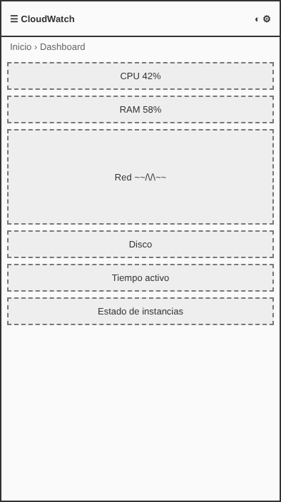
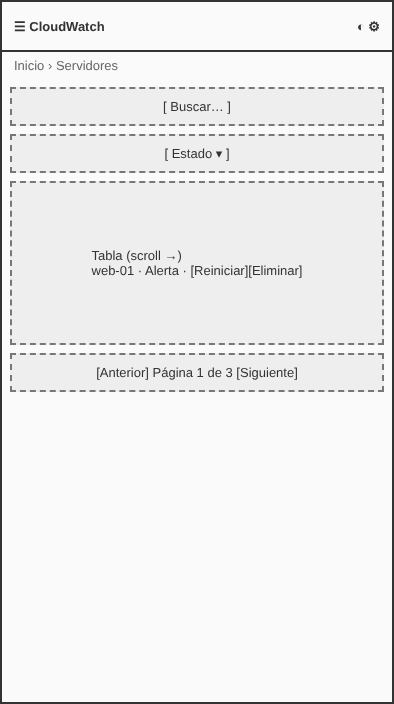
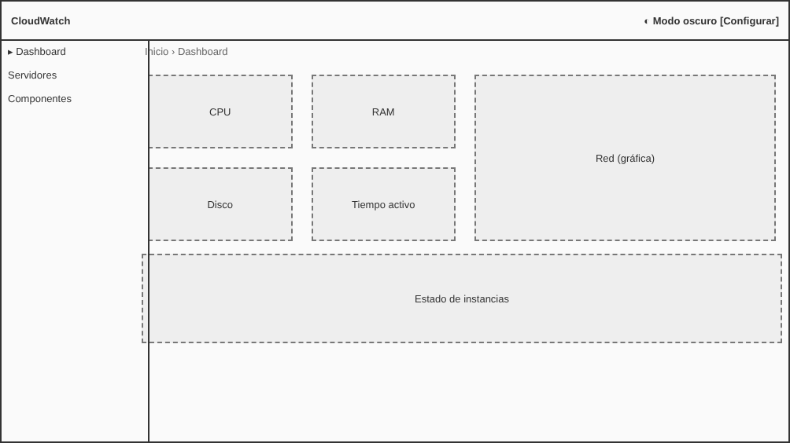
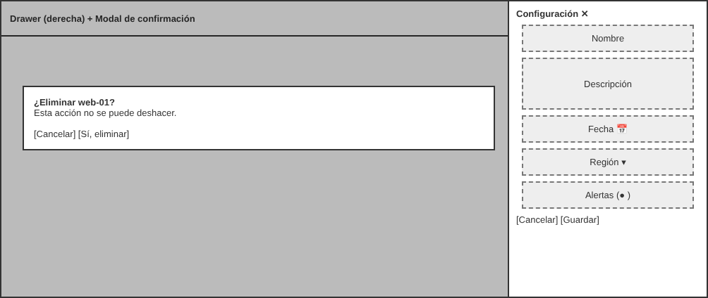

# Prototipo UX: CloudWatch Dashboard SPA

**Enlace público de Figma:** ____________  *(ver instrucciones al final)*

# User Persona: Ingeniera Cloud / DevOps

| | |
|---|---|
| **Nombre** | Valeria Ríos, 32 años |
| **Rol** | Ingeniera Cloud / DevOps senior en una empresa de infraestructura |
| **Nivel técnico** | Alto: Linux, Docker, Kubernetes, Terraform, CI/CD |
| **Dispositivos** | Laptop con 2 monitores en el trabajo; smartphone cuando está de guardia |

**Metas**
- Detectar en segundos qué instancia está degradada.
- Reiniciar o ajustar un servicio sin cometer errores.
- Atender incidentes desde el teléfono con la misma claridad que en escritorio.

**Frustraciones**
- Paneles saturados donde no se distingue lo urgente.
- Acciones destructivas sin confirmación (o con confirmaciones vagas).
- Interfaces que no funcionan bien en móvil durante una guardia.
- Depender solo del color para saber el estado de un servidor.

**Escenarios de uso cotidiano**
1. **Revisión matutina:** abre el dashboard, revisa CPU, RAM, red y disco, y confirma que no haya instancias en alerta.
2. **Incidente a las 3 a. m.:** desde el móvil filtra por "Alerta", abre la instancia y la reinicia confirmando en el modal.
3. **Cambio planificado:** abre el drawer de configuración, ajusta región y fecha de mantenimiento, y activa las alertas por correo.

> Recomendación: valida esta ficha con 2 o 3 entrevistas breves a personas reales del perfil y ajústala.

## Wireframes de baja fidelidad
Solo distribución espacial, sin estética.

| Dashboard móvil (390 px) | Servidores móvil |
|---|---|
|  |  |

**Dashboard escritorio (Bento Grid)**

**Drawer de configuración y modal de confirmación**

## Flujo del prototipo interactivo
Dashboard → Servidores (filtrar "Alerta") → clic en **Reiniciar** → modal de confirmación → toast "Instancia reiniciada". Segundo flujo: **Configurar** → drawer → **Guardar cambios** (Loading) → toast.

## Cómo llevarlo a Figma (10 min)
1. Crea frames de 390×844 (móvil) y 1440×900 (escritorio) y arrastra ahí los PNG de `docs/img/wf-*.png` como referencia.
2. Redibuja con rectángulos y texto sobre ellos; conecta en modo *Prototype*: Dashboard→Servidores, botón Reiniciar→Modal, Configurar→Drawer (*Smart animate*, 300 ms).
3. *Share* → "Anyone with the link can view" y pega el enlace arriba y en el reporte.
