# Reporte técnico de validación: CloudWatch Dashboard SPA

**Alumno:** ____________  **Fecha:** 10/11/2026  **Repositorio:** ____________  **Prototipo Figma:** ____________

Las capturas se generaron con Chromium automatizado (Playwright) sobre el proyecto real. Las mediciones de la sección 4 salieron de pruebas automáticas, no de estimaciones.

## 1. Los 5 estados de cada control
Vista `#/componentes`: botón primario, secundario, destructivo, campo de texto y dropdown en Default, Hover, Focus (contorno visible), Disabled y Loading.

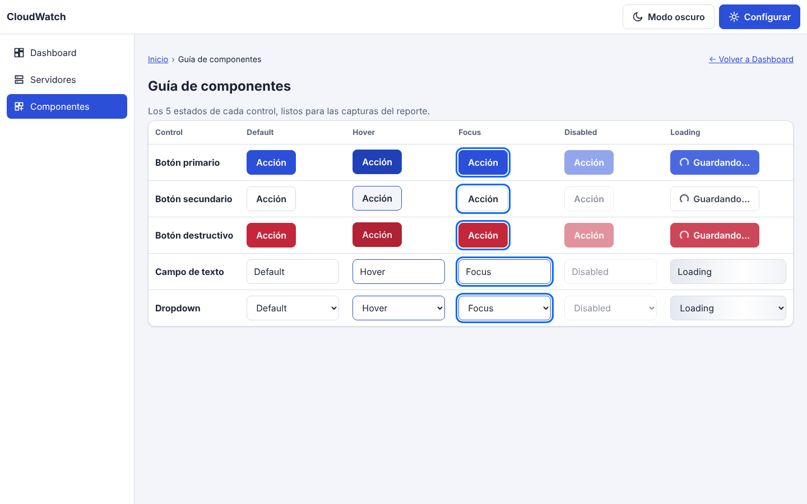

Loading en un caso real: el botón "Guardar cambios" del drawer muestra spinner, queda deshabilitado y con `aria-busy="true"`, por lo que no admite reenvío.

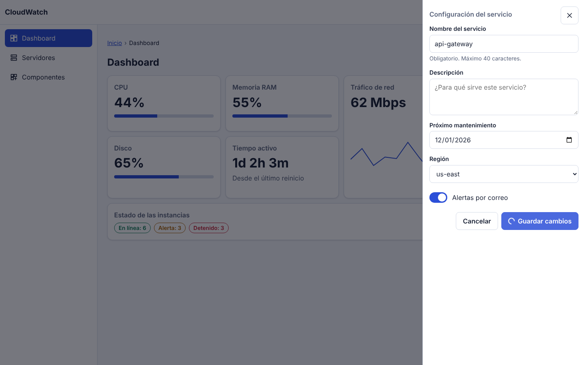

## 2. Vista responsiva (mobile-first)
| Móvil (390 px) | Tableta (768 px) | Escritorio (1440 px) |
|---|---|---|
| 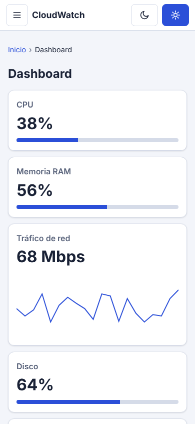 | 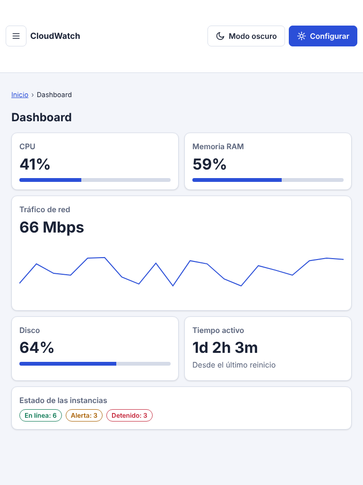 | 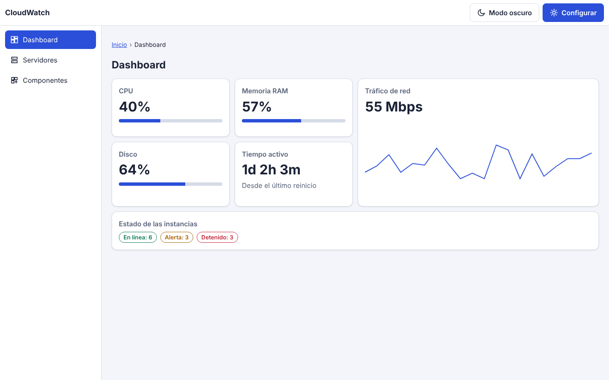 |

Sin desbordamiento horizontal en 390 px ni en 768 px (la tabla hace scroll dentro de su contenedor). Menú móvil y tabla en móvil:

| Sidebar retráctil | Servidores |
|---|---|
| 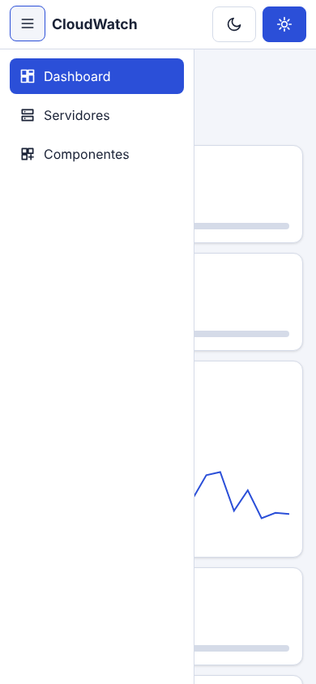 | 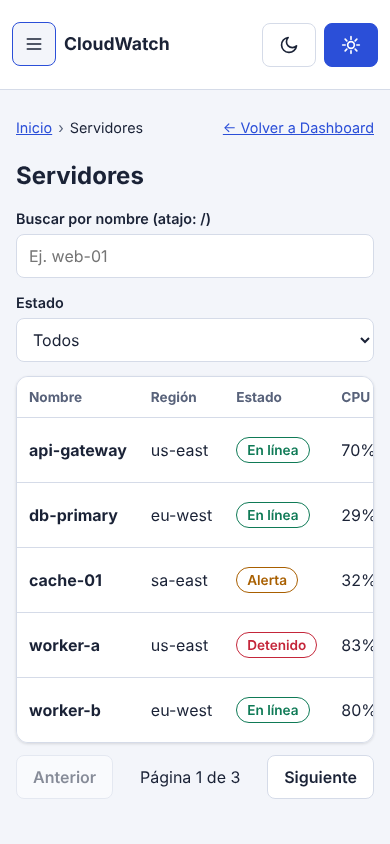 |

## 3. Zona 3 y modo oscuro
| Drawer | Modal de confirmación |
|---|---|
| 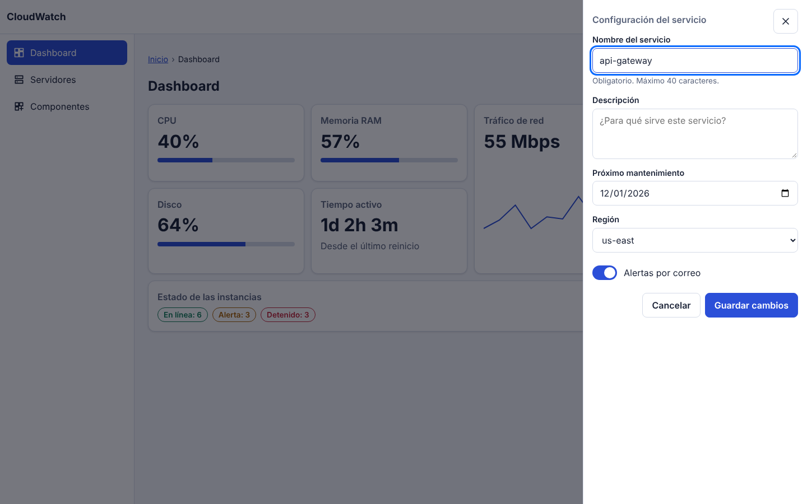 | 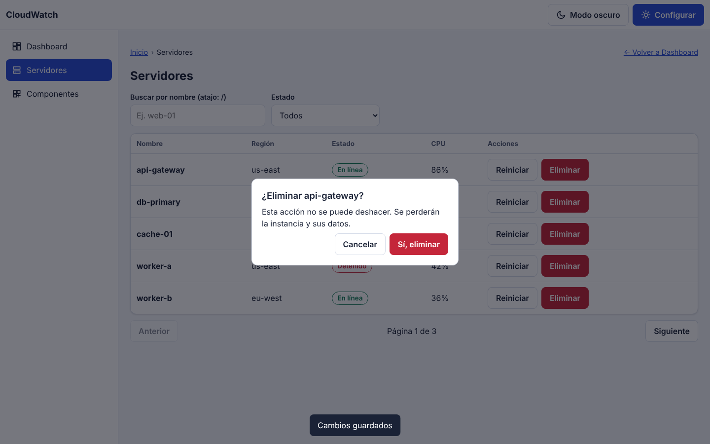 |

| Toggle manual | `prefers-color-scheme: dark` (emulado) |
|---|---|
| 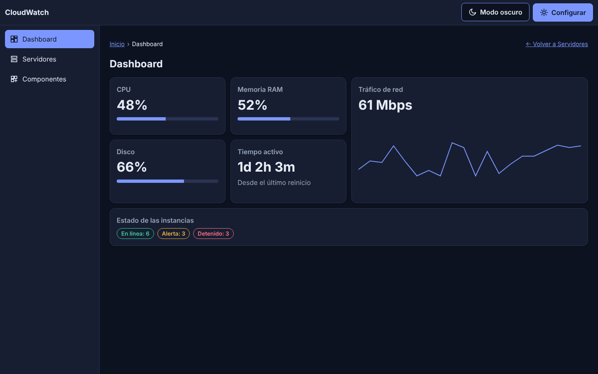 | 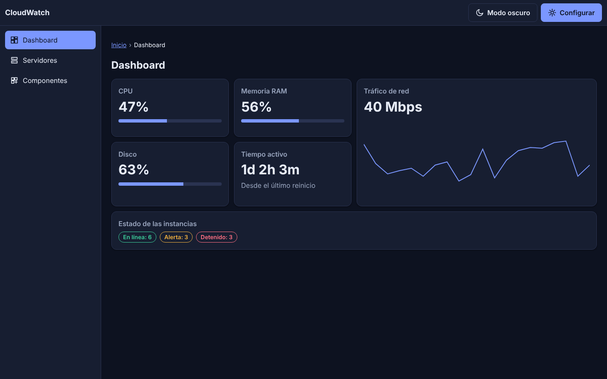 |

## 4. Checklist de las 5 dimensiones de IxD
| Dimensión | Qué se aplicó | Evidencia (medida) | Cumple |
|---|---|---|---|
| **1D Palabras** | Etiquetas claras, botones con verbo ("Sí, eliminar", "Guardar cambios"), ayuda bajo el campo, mensaje de tabla vacía que sugiere qué hacer | Modal, drawer y tabla filtrada | ✅ |
| **2D Visuales** | Íconos SVG consistentes, jerarquía tipográfica, paleta funcional con variables CSS; estados con texto además de color | Header, sidebar, badges | ✅ |
| **3D Objetos físicos** | Zona táctil mínima de 44×44 px | Inputs, selects y switch: 44 px. Enlaces de menú y breadcrumbs: 44 px (se corrigió: medían 17 px). Botones: 44 px* | ✅ |
| **4D Tiempo** | Transiciones controladas y spinners en carga | Botones y tarjetas 250 ms; drawer y modal 300 ms (rango pedido: 200–350 ms). Guardar: spinner 1 s | ✅ |
| **5D Comportamiento** | Atajos y reglas lógicas | `Esc` cierra modal y drawer; el foco vuelve al botón que abrió el drawer; `/` abre y enfoca el buscador (se corrigió: el foco terminaba en `main`); doble envío bloqueado | ✅ |

\* La prueba midió 41 px en 2 botones del modal estando cerrado: es el efecto de su escala de animación (0.95 × 44 px). Abierto mide 44 px.

## 5. Conclusiones
La interfaz cumple las tres zonas (navegación, contenido dinámico e interacción crítica), usa Grid para el layout y el Bento, Flexbox para componentes de una dimensión, y funciona en claro y oscuro. Las pruebas automáticas detectaron y permitieron corregir dos defectos: breadcrumbs demasiado pequeños para táctil y pérdida de foco con el atajo `/`. Pendiente de mejora: medir contraste WCAG y probar con lector de pantalla.
